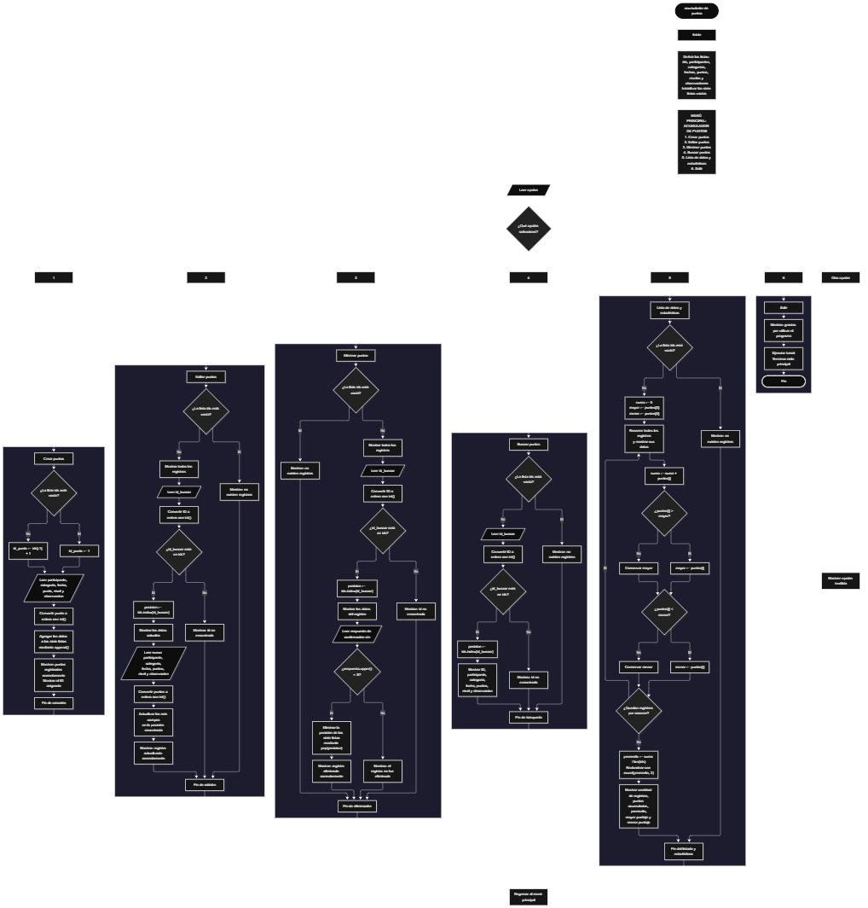

 

Este proyecto, llamado <b>acumulador de puntos</b>, fue desarrollado en <b>python</b> como un ejercicio práctico para fortalecer la lógica de programación mediante la creación de un sistema de gestión y acumulación de puntos desde la consola. El programa cuenta con un menú principal de seis opciones que permite <b>crear, editar, eliminar, buscar y listar registros</b>, además de consultar estadísticas relacionadas con los puntos almacenados. Cada registro contiene información como el nombre del participante, la categoría, la fecha, la cantidad de puntos, el nivel y una observación. Para organizar los datos, se utilizan siete listas paralelas que almacenan temporalmente la información durante la ejecución del programa. Entre las estadísticas disponibles se encuentran la cantidad de registros, los puntos acumulados, el promedio de puntos, el mayor puntaje y el menor puntaje. Durante su desarrollo se aplicaron conceptos fundamentales de programación, como variables, listas, estructuras condicionales, ciclos repetitivos, selección de opciones, búsqueda por identificador, modificación de registros y operaciones matemáticas. Este proyecto permite poner en práctica los conocimientos adquiridos en Python y sirve como base para desarrollar sistemas de gestión de puntos más avanzados utilizando otros lenguajes y tecnologías.

<h2 align="center">⚙️ Funcionamiento del menú principal</h2>

### ➕ Crear puntos

La opción <b>1) crear puntos</b> permite registrar un nuevo participante o registro de puntos en el sistema. Antes de almacenar la información, el programa comprueba si la lista <b>ids</b> está vacía mediante la condición <b>len(ids) == 0</b>. Si no existen registros, asigna el identificador <b>1</b> a la variable <b>id_punto</b>. En caso contrario, genera el siguiente identificador utilizando el último valor de la lista mediante la expresión <b>ids[-1] + 1</b>. Después, solicita el <b>nombre del participante, la categoría, la fecha del registro, la cantidad de puntos, el nivel y la observación</b>. La cantidad de puntos se convierte a un número entero mediante la función <b>int()</b>. Una vez introducidos los datos, el programa utiliza el método <b>append()</b> para almacenar cada valor en su lista correspondiente: <b>ids, participantes, categorias, fechas, puntos, niveles y observaciones</b>. Finalmente, muestra el mensaje <b>"puntos registrados correctamente."</b> y presenta el identificador asignado al registro. Esta opción permite incorporar nuevos datos al sistema durante la ejecución del programa.

### ✏️ Editar puntos

La opción <b>2) editar puntos</b> permite modificar la información de un registro existente. Primero, el programa comprueba si la lista <b>ids</b> está vacía. Si no existen registros, muestra el mensaje <b>"no existen registros."</b>. En caso contrario, presenta todos los registros almacenados mediante un ciclo <b>for</b>, mostrando el identificador, participante, categoría, fecha, cantidad de puntos, nivel y observación. Después, solicita el identificador del registro que se desea editar mediante la variable <b>id_buscar</b>, cuyo valor se convierte a entero utilizando <b>int()</b>. El programa comprueba si el identificador existe en la lista <b>ids</b> mediante la condición <b>id_buscar in ids</b>. Si lo encuentra, utiliza <b>ids.index(id_buscar)</b> para obtener la posición correspondiente y muestra los datos actuales. A continuación, solicita la nueva información del participante, categoría, fecha, cantidad de puntos, nivel y observación, actualizando directamente los valores de las listas en la posición encontrada. La cantidad de puntos se convierte nuevamente a entero mediante <b>int()</b>. Finalmente, presenta el mensaje <b>"registro actualizado correctamente."</b>. Si el identificador no existe, muestra el mensaje <b>"id no encontrada."</b>. El identificador original se conserva durante la modificación.

### 🗑️ Eliminar puntos

La opción <b>3) eliminar puntos</b> permite eliminar un registro almacenado en el sistema. Antes de realizar la operación, el programa comprueba si existen registros mediante la longitud de la lista <b>ids</b>. Si la lista está vacía, muestra el mensaje <b>"no existen registros."</b>. Si hay información disponible, presenta todos los registros utilizando un ciclo <b>for</b>. Después, solicita el identificador del registro que se desea eliminar y comprueba si se encuentra en la lista <b>ids</b>. Si existe, obtiene su posición mediante <b>ids.index(id_buscar)</b> y muestra todos los datos correspondientes. A continuación, solicita una confirmación mediante la pregunta <b>"¿desea eliminar este registro? (s/n):"</b>. La respuesta se convierte a mayúsculas utilizando <b>upper()</b> y se compara con el valor <b>"S"</b>. Si la respuesta coincide, el programa utiliza el método <b>pop(posicion)</b> para eliminar la misma posición de las siete listas paralelas: <b>ids, participantes, categorias, fechas, puntos, niveles y observaciones</b>. Después, muestra el mensaje <b>"registro eliminado correctamente."</b>. Si la respuesta es diferente de <b>"S"</b>, presenta el mensaje <b>"el registro no fue eliminado."</b> y conserva la información. Si el identificador introducido no existe, muestra el mensaje <b>"id no encontrada."</b>. De esta manera, los datos asociados al registro se eliminan de forma coordinada.

### 🔎 Buscar puntos

La opción <b>4) buscar puntos</b> permite localizar un registro mediante su identificador. Primero, el programa comprueba si existen datos almacenados en la lista <b>ids</b>. Si no hay registros, muestra el mensaje <b>"no existen registros."</b>. En caso contrario, solicita el identificador que se desea buscar y convierte la entrada a un número entero mediante <b>int()</b>. Después, utiliza la condición <b>id_buscar in ids</b> para comprobar si el identificador se encuentra registrado. Si existe, obtiene su posición mediante <b>ids.index(id_buscar)</b> y muestra la información completa del registro, incluyendo el identificador, participante, categoría, fecha, puntos, nivel y observación. Si el identificador no se encuentra en la lista, presenta el mensaje <b>"id no encontrada."</b>. Esta funcionalidad permite consultar individualmente la información almacenada sin modificar ni eliminar el registro.

### 📋 Lista de datos y estadísticas

La opción <b>5) lista de datos</b> permite visualizar todos los registros almacenados y calcular estadísticas relacionadas con los puntos. Primero, el programa comprueba si existen registros. Si la lista <b>ids</b> está vacía, muestra el mensaje <b>"no existen registros."</b>. Si hay datos disponibles, inicializa la variable <b>suma</b> con el valor <b>0</b> y establece las variables <b>mayor</b> y <b>menor</b> con el primer valor de la lista <b>puntos[0]</b>. Después, utiliza un ciclo <b>for</b> para recorrer todos los registros, mostrar sus datos y acumular los puntos mediante la operación <b>suma += puntos[i]</b>. Durante el recorrido, compara cada cantidad de puntos con los valores de <b>mayor</b> y <b>menor</b> para actualizar el puntaje máximo y mínimo cuando corresponde. Una vez finalizado el ciclo, calcula el promedio mediante la expresión <b>suma / len(ids)</b> y utiliza la función <b>round(promedio, 2)</b> para redondear el resultado a dos decimales. Finalmente, presenta las estadísticas del sistema: <b>cantidad de registros, puntos acumulados, promedio de puntos, mayor puntaje y menor puntaje</b>. Esta opción permite consultar tanto la información individual de los registros como un resumen numérico de los puntos almacenados.

### 🚪 Salir del menú principal

La opción <b>6) salir</b> permite finalizar la ejecución del programa. Cuando el usuario selecciona esta opción, el sistema muestra el mensaje <b>"gracias por utilizar el programa."</b> y ejecuta la instrucción <b>break</b>, que interrumpe el ciclo repetitivo <b>while True</b>. De esta manera, el programa deja de mostrar el menú principal y termina su ejecución. Si el usuario introduce una opción diferente de los valores comprendidos entre <b>1 y 6</b>, el programa ejecuta el bloque <b>else</b> y muestra el mensaje <b>"opción inválida."</b>, para indicar que la selección no corresponde a ninguna de las opciones disponibles.

<h2 align="center">🧠 Temas aplicados en el proyecto</h2>

### 📦 Variables

En este proyecto se utilizan variables para almacenar temporalmente los datos introducidos por el usuario, controlar la opción seleccionada en el menú, identificar los registros que se desean modificar o eliminar y realizar los cálculos estadísticos. Cada variable cumple una función específica dentro de las operaciones del sistema, permitiendo administrar la información y ejecutar los procedimientos de manera organizada.

🔢 <b>opcion:</b> Almacena la opción seleccionada por el usuario en el menú principal.

🆔 <b>id_punto:</b> Almacena el identificador asignado al nuevo registro.

👤 <b>participante:</b> Almacena el nombre del participante durante la creación de un registro.

🏷️ <b>categoria:</b> Almacena la categoría asociada al registro.

📅 <b>fecha:</b> Almacena la fecha del registro.

⭐ <b>punto:</b> Almacena la cantidad de puntos introducida durante la creación de un registro.

🥉 <b>nivel:</b> Almacena el nivel indicado para el registro.

📝 <b>observacion:</b> Almacena información adicional del registro.

🔎 <b>id_buscar:</b> Almacena el identificador que se desea localizar para buscar, editar o eliminar un registro.

📍 <b>posicion:</b> Almacena el índice correspondiente al registro encontrado dentro de las listas.

🔄 <b>i:</b> Funciona como contador en los ciclos <b>for</b> utilizados para recorrer y mostrar los registros, así como para calcular las estadísticas.

❓ <b>respuesta:</b> Almacena la respuesta del usuario durante la confirmación de eliminación.

➕ <b>suma:</b> Acumula las cantidades de puntos de todos los registros existentes.

📈 <b>mayor:</b> Almacena el mayor puntaje encontrado durante el recorrido de la lista.

📉 <b>menor:</b> Almacena el menor puntaje encontrado durante el recorrido de la lista.

📊 <b>promedio:</b> Almacena el resultado de dividir la suma de los puntos entre la cantidad de registros.

### 🗃️ Listas paralelas

En este proyecto se utilizan siete listas paralelas para organizar los datos de cada registro. Todas mantienen una correspondencia por posición, de modo que los elementos que comparten el mismo índice representan la información de un mismo registro. Por ejemplo, los valores de <b>participantes[0], categorias[0], fechas[0], puntos[0], niveles[0] y observaciones[0]</b> corresponden al registro cuyo identificador se encuentra en <b>ids[0]</b>. Esta organización permite almacenar, consultar, modificar y eliminar la información de forma coordinada. Las listas se crean vacías y aumentan o disminuyen su tamaño según las operaciones que realiza el usuario durante la ejecución del programa.

🆔 <b>ids:</b> Almacena los identificadores de los registros.

👤 <b>participantes:</b> Almacena los nombres de los participantes.

🏷️ <b>categorias:</b> Almacena las categorías de los registros.

📅 <b>fechas:</b> Almacena las fechas asociadas a los registros.

⭐ <b>puntos:</b> Almacena las cantidades de puntos registradas como números enteros.

🥇 <b>niveles:</b> Almacena los niveles indicados para cada registro.

📝 <b>observaciones:</b> Almacena las observaciones adicionales de cada registro.

### 🔀 Estructuras condicionales

En este proyecto se utilizan las estructuras condicionales <b>if, elif y else</b> para controlar el funcionamiento del menú y las operaciones de gestión de puntos. Estas estructuras permiten comprobar si existen registros antes de realizar una operación, determinar si un identificador se encuentra almacenado, decidir si se deben actualizar o eliminar datos y comprobar la respuesta introducida durante la confirmación de eliminación. También permiten mostrar un mensaje de opción inválida cuando el usuario introduce un valor que no corresponde a las opciones disponibles. Gracias a estas condiciones, el programa puede ejecutar diferentes instrucciones según el resultado de cada comprobación.

### 🔄 Estructuras repetitivas

En este proyecto se utilizan los ciclos <b>while</b> y <b>for</b> para controlar la ejecución del programa y recorrer los registros almacenados. El ciclo <b>while True</b> mantiene activo el menú principal y permite que el usuario seleccione diferentes operaciones hasta ejecutar la instrucción <b>break</b>. Por otro lado, los ciclos <b>for</b> permiten recorrer las listas mediante la expresión <b>range(len(ids))</b>, mostrar los registros existentes y acceder a sus datos mediante el índice correspondiente. En la opción de estadísticas, el ciclo también permite acumular los puntos y comparar los valores para encontrar el mayor y el menor puntaje.

### 🎯 Selección del menú mediante condicionales

El programa utiliza una cadena de condiciones <b>if, elif y else</b> para determinar qué operación debe ejecutarse según el valor almacenado en la variable <b>opcion</b>. Cada condición corresponde a una funcionalidad del sistema: crear puntos, editar puntos, eliminar puntos, buscar puntos, listar datos y estadísticas, o salir del programa. Cuando ninguna de las condiciones coincide con la entrada del usuario, se ejecuta el bloque <b>else</b> y se muestra el mensaje <b>"opción inválida."</b>. Esta estructura organiza las diferentes funcionalidades dentro de un único menú principal.

### 🔎 Búsqueda por identificador

La búsqueda de registros se realiza mediante la lista <b>ids</b> y los métodos de pertenencia e identificación de posición. La expresión <b>id_buscar in ids</b> comprueba si el identificador introducido existe en la lista, mientras que <b>ids.index(id_buscar)</b> obtiene el índice del identificador encontrado. Este índice se utiliza para consultar o modificar los datos correspondientes en las demás listas paralelas. El mismo procedimiento se emplea en las opciones de edición, eliminación y búsqueda, evitando tener que recorrer manualmente cada lista para localizar un registro específico.

### 🧰 Métodos de listas

El programa utiliza diferentes operaciones sobre listas para administrar los registros. El método <b>append()</b> incorpora nuevos datos al final de cada lista durante la creación de un registro. El método <b>index()</b> permite localizar la posición de un identificador existente y el método <b>pop()</b> elimina un elemento de una posición determinada. También se utiliza el operador <b>in</b> para comprobar si un identificador se encuentra almacenado. Estas operaciones permiten gestionar los datos sin necesidad de establecer una capacidad fija para las listas.

### 🔢 Conversión de tipos de datos

En este proyecto se utiliza la función <b>int()</b> para convertir las entradas del usuario que representan identificadores y cantidades de puntos a números enteros. Esta conversión permite realizar comparaciones numéricas, sumar los puntos registrados y calcular estadísticas. Sin embargo, el programa no utiliza un bloque <b>try/except</b> para gestionar entradas que no puedan convertirse a enteros, por lo que introducir texto u otros valores no válidos puede provocar un error durante la ejecución.

### 📊 Acumulación y cálculo de estadísticas

El cálculo de estadísticas se realiza en la opción <b>5) lista de datos</b>. La variable <b>suma</b> comienza en cero y acumula los puntos de cada registro mediante <b>suma += puntos[i]</b>. Las variables <b>mayor</b> y <b>menor</b> se inicializan con el primer elemento de la lista de puntos, lo que permite comparar los demás valores sin establecer un puntaje inicial arbitrario. Durante el recorrido, las condiciones <b>puntos[i] &gt; mayor</b> y <b>puntos[i] &lt; menor</b> actualizan los resultados cuando se encuentra un valor superior o inferior. Al terminar, el promedio se calcula dividiendo la suma entre el número de registros y se redondea a dos decimales mediante <b>round()</b>. Estas operaciones permiten obtener un resumen estadístico de los puntos registrados.

### 🆔 Generación de identificadores

La asignación de identificadores se realiza automáticamente durante la creación de registros. Si la lista <b>ids</b> está vacía, el programa asigna el valor <b>1</b>. Si existen registros, obtiene el último identificador almacenado mediante <b>ids[-1]</b> y le suma uno. Este procedimiento permite identificar cada nuevo registro sin solicitar al usuario que introduzca manualmente el ID. Sin embargo, como el identificador se calcula a partir del último elemento de la lista, al eliminar el registro que tiene el ID más alto y crear otro posteriormente, el identificador eliminado podría volver a utilizarse.

<h2 align="center">¿Cómo se implementaron las operaciones crud en el proyecto?</h2>

Las operaciones <b>crud</b> se implementaron mediante las opciones del menú principal, permitiendo administrar los registros de puntos. La operación <b>crear</b> corresponde a <b>crear puntos</b>, donde se introducen los datos de un nuevo registro y se almacenan en las listas paralelas. La operación <b>leer</b> se realiza mediante las opciones <b>buscar puntos</b> y <b>lista de datos</b>, que permiten consultar un registro individual o visualizar todos los registros junto con sus estadísticas. La operación <b>actualizar</b> corresponde a <b>editar puntos</b>, donde se modifican los datos de un registro existente sin cambiar su identificador. Finalmente, la operación <b>eliminar</b> corresponde a <b>eliminar puntos</b>, donde el usuario selecciona un registro y confirma si desea eliminarlo. Todas estas operaciones trabajan con las siete listas paralelas y mantienen la información únicamente durante la ejecución del programa.

<h2 align="center">Diagrama de flujo del proyecto</h2>

<h2 align="center">🛡️ Validaciones del programa</h2>

### 📭 No existen registros

Esta comprobación se utiliza en las opciones de <b>editar puntos, eliminar puntos, buscar puntos y lista de datos</b>. El programa verifica si la lista <b>ids</b> está vacía mediante la condición <b>len(ids) == 0</b>. Si no existen registros, muestra el mensaje <b>"no existen registros."</b> y evita continuar con la operación solicitada. Esta comprobación permite controlar las operaciones que necesitan datos previamente almacenados. La opción de creación no requiere registros existentes, ya que puede asignar el primer identificador cuando las listas están vacías.

### ❌ Identificador no encontrado

Esta comprobación se utiliza en las opciones de <b>editar puntos, eliminar puntos y buscar puntos</b>. Después de solicitar el identificador mediante la variable <b>id_buscar</b>, el programa comprueba si el valor introducido se encuentra en la lista <b>ids</b>. Si existe, obtiene su posición y ejecuta la operación correspondiente. Si no existe, muestra el mensaje <b>"id no encontrada."</b>. Esta comprobación evita intentar acceder mediante <b>ids.index(id_buscar)</b> a un identificador que no está almacenado.

### ❓ Confirmación de eliminación

Esta comprobación se realiza antes de eliminar un registro. El programa solicita al usuario que confirme la operación y almacena la respuesta en la variable <b>respuesta</b>. Después, utiliza <b>respuesta.upper() == "S"</b> para comprobar si la respuesta corresponde a la letra <b>S</b>, independientemente de que se introduzca en mayúscula o minúscula. Si la condición se cumple, elimina el registro de las siete listas mediante <b>pop(posicion)</b>. Si no se cumple, muestra el mensaje <b>"el registro no fue eliminado."</b> y conserva los datos almacenados.

### 🔢 Conversión de entradas numéricas

El programa utiliza la función <b>int()</b> para convertir los identificadores introducidos durante las operaciones de edición, eliminación y búsqueda, así como las cantidades de puntos durante la creación y edición de registros. Esta conversión permite trabajar con valores enteros. Sin embargo, el código no incluye un manejo de excepciones mediante <b>try/except</b>, por lo que una entrada que no pueda convertirse a entero puede interrumpir la ejecución del programa. Por esta razón, actualmente no existe una validación que permita recuperar la ejecución después de introducir un valor numérico incorrecto.

### ⚠️ Cantidad de puntos y nivel

Durante la creación y edición de registros, el programa solicita la cantidad de puntos y el nivel correspondiente. La cantidad de puntos se convierte a entero mediante <b>int()</b>, pero no se comprueba que sea mayor o igual a cero, por lo que actualmente se pueden registrar cantidades negativas. Asimismo, aunque se solicita indicar un nivel entre <b>bronce, plata, oro y platino</b>, el programa no verifica que el texto introducido coincida con una de esas opciones. Estas condiciones describen limitaciones del código actual y no validaciones implementadas.

### 🆔 Identificadores de los registros

El programa genera los identificadores de forma automática a partir de los elementos existentes en la lista <b>ids</b>. Cuando no hay registros, asigna el identificador <b>1</b>; en caso contrario, utiliza el último identificador más uno. Este procedimiento permite asignar IDs durante la creación de registros, pero no mantiene un contador independiente de identificadores utilizados anteriormente. Por ello, si se elimina el último registro y después se crea otro, el ID eliminado podría reutilizarse. Actualmente, el programa tampoco comprueba la existencia de campos vacíos antes de almacenar o actualizar la información.

### ⚠️ Opción inválida

La estructura condicional que controla el menú incluye un bloque <b>else</b> para gestionar las opciones que no coinciden con los valores definidos. Si el usuario introduce una opción diferente de <b>1, 2, 3, 4, 5 o 6</b>, el programa muestra el mensaje <b>"opción inválida."</b>. Después de mostrar este mensaje, el ciclo <b>while True</b> continúa y vuelve a presentar el menú principal, permitiendo que el usuario realice otra selección.

### 💾 Almacenamiento temporal de la información

Los registros se almacenan en listas creadas al comienzo del programa y permanecen disponibles mientras se mantiene activa la ejecución. El código no utiliza archivos, bases de datos ni mecanismos de persistencia para conservar la información después de cerrar el programa. Por tanto, al finalizar la ejecución, los registros almacenados en memoria dejan de estar disponibles. Las listas paralelas también deben mantenerse sincronizadas para asegurar que los datos de cada posición correspondan al mismo registro.

<h2 align="center">🎯 Objetivo del proyecto</h2>

El objetivo principal de este proyecto es fortalecer la <b>lógica de programación</b> mediante el desarrollo de un sistema de gestión y acumulación de puntos en <b>python</b>. A través de su construcción se busca aplicar conocimientos sobre variables, listas, estructuras condicionales, ciclos repetitivos, búsqueda por identificador y operaciones matemáticas, integrándolos para resolver un problema de manera organizada. Además, el proyecto permite comprender cómo crear, consultar, modificar y eliminar registros, así como obtener estadísticas a partir de los datos almacenados. De esta manera, se establece una base para desarrollar aplicaciones de consola más completas y ampliar posteriormente las funcionalidades mediante almacenamiento permanente, validaciones adicionales y otras herramientas de programación.

